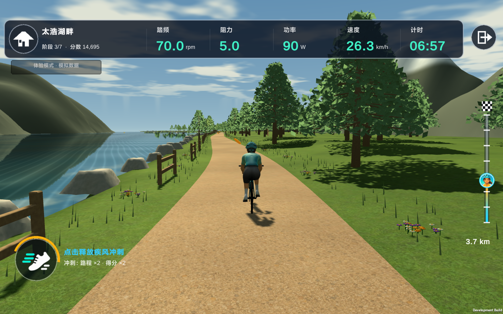

# Wind Trace Ride

[简体中文](README.md) · English

Wind Trace Ride is an indoor cycling adventure for Android. Connect a Bluetooth exercise bike and your cadence moves the rider through lakeside trails, a wind canyon and a windmill village. Collect wind energy to boost and match target cadences to build combos.

**[Android releases](https://github.com/limings/WindTraceRide/releases)** · [Run from source](#run-from-source) · [Report bike compatibility](https://github.com/limings/WindTraceRide/issues/new?template=bike-compatibility.md)

## Play on Android

The Android preview APK is in preparation. In the meantime, you can run the game from source in the Unity editor. The game has English and Chinese interfaces.

1. Open Settings and choose **Start demo · simulated ride** to play without a bike. On Android, you can also wake your bike, choose **Scan for trainers**, allow Bluetooth access and connect.
2. Return to the home screen and choose a course.

The game reads Bluetooth FTMS Indoor Bike Data and legacy `0xFFF0` telemetry from the YESOUL S1. Available readings depend on the bike and firmware. Adjust resistance on the bike. If you try a real bike, please share the model, connection result and how closely the on-screen cadence follows your pedaling. [Compatibility feedback](https://github.com/limings/WindTraceRide/issues/new?template=bike-compatibility.md)

## Run from source

Open the repository in Unity **6000.0.60f1**, load `Assets/Scenes/Bootstrap.unity` and press Play. Demo mode also works in the editor. Install Unity's Android Build Support to build an APK. [Build instructions and project structure](README.md#构建-android)

Wind Trace Ride is source-available and free for personal, noncommercial use. Commercial use requires written authorization. [License](LICENSE)
